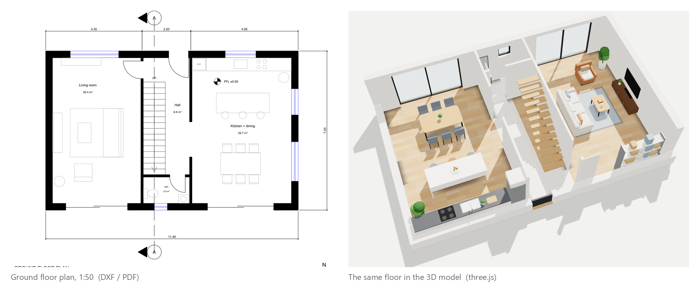
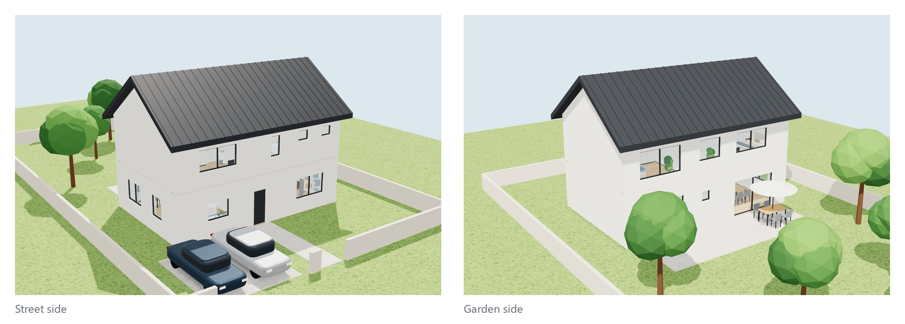
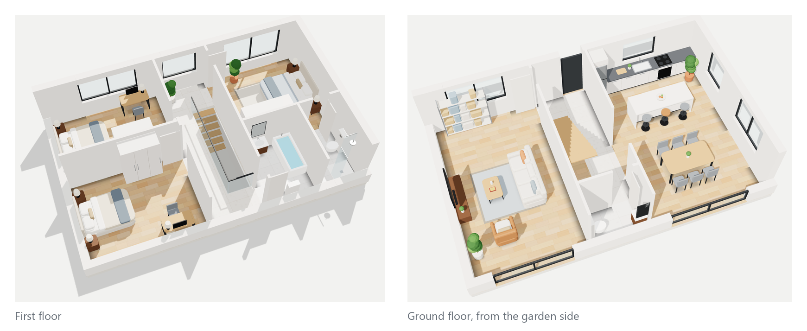
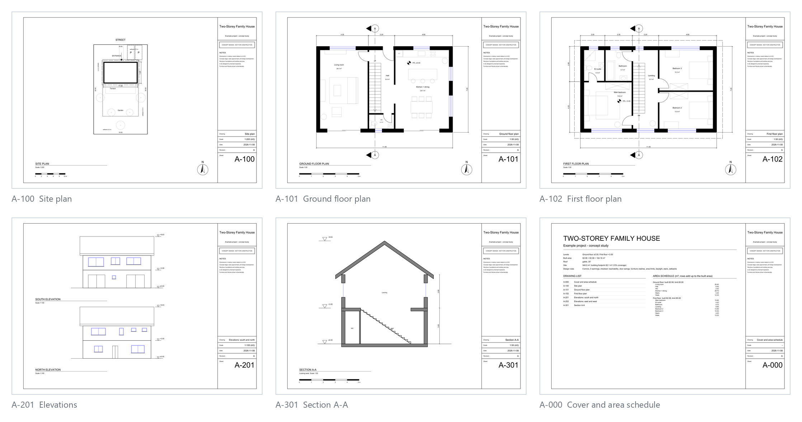

<div align="center">

# Architectural Concept Design

**An agent skill that turns a building brief into a checked concept design.**<br>
The agent writes one JSON design model. A bundled engine checks it against design rules, then
generates CAD drawings, a furnished 3D model and an exact area schedule.

[](https://github.com/Mhrnqaruni/ai-agent-skill-architectural-concept-design/actions/workflows/ci.yml)
[](https://github.com/Mhrnqaruni/ai-agent-skill-architectural-concept-design/releases)
[](https://agentskills.io/specification)

[](LICENSE)

[Install](#install) · [Example](#what-you-get) · [How it works](#how-it-works) ·
[Design rules](#design-rules) · [Evaluation](#evaluation) · [SKILL.md](skills/architectural-concept-design/SKILL.md)



<sub><b>Figure 1.</b> The ground floor of the example project as a 1:50 CAD plan (left) and in the generated 3D
model (right). Both come from the same design model.</sub>

</div>

## Overview

Coding agents can write code, but a floor plan they draw freehand is unchecked: doors swing
into beds, rooms have no way in, and areas are guessed. This skill gives the agent an
architect's concept-stage workflow and a deterministic engine to work with. The agent handles
the design thinking: the brief, decision questions, the specification and the layout. The engine
handles geometry, rules and drawing.

```text
brief ──► requirement matrix ──► decision questions ──► specification ──► design.json
                                                                              │
              ┌───────────────────── fix and repeat ◄──── design rules ◄─────┘
              ▼
   drawings (DXF · PDF · PNG)   +   furnished 3D model (HTML)   +   area schedule
```

## Highlights

- **One source of truth.** Every drawing, the 3D model and the area schedule are generated from
  one `design.json`, so they cannot disagree.
- **Rules before drawings.** Reachability, door swings, furniture clashes, area limits and
  setbacks are errors that stop the build. Daylight, stairs, door widths and room sizes are
  warnings.
- **A real drawing set.** A3 sheets: cover with area schedule, site plan, a plan per level, four
  elevations and a section. Each is DXF R2018 on AIA / NCS layers, rendered to PDF and PNG, and
  every DXF is audited.
- **A furnished 3D model in one file.** three.js with cutaway levels, 30 furniture types,
  procedural materials and the site. It works offline and renders headlessly to PNG.
- **Agent-friendly by design.** The JSON Schema and validation messages point at the exact
  field to fix. `check --json` returns machine-readable findings, and `build` refuses to write
  anything while an error remains.
- **Portable.** Follows the open Agent Skills format, so it works in Claude Code, Codex and
  other compatible agents. It needs only Python, `ezdxf`, `PyMuPDF` and `Pillow`.

## Install

The skill is the folder [`skills/architectural-concept-design`](skills/architectural-concept-design).
Install it the way your agent expects:

| Agent | Install |
|---|---|
| Claude Code (plugin) | `/plugin marketplace add Mhrnqaruni/ai-agent-skill-architectural-concept-design`, then `/plugin install architectural-concept-design@architectural-concept-design` |
| Claude Code (manual) | copy the folder to `~/.claude/skills/` (all projects) or `.claude/skills/` (one project) |
| Codex | copy the folder to `~/.codex/skills/`, or ask Codex to install it with `$skill-installer` and the URL `https://github.com/Mhrnqaruni/ai-agent-skill-architectural-concept-design/tree/main/skills/architectural-concept-design` |
| Any agent (skills CLI) | `npx skills add Mhrnqaruni/ai-agent-skill-architectural-concept-design` |
| Claude apps | download `architectural-concept-design.zip` from the [latest release](https://github.com/Mhrnqaruni/ai-agent-skill-architectural-concept-design/releases/latest) and upload it under Settings > Capabilities > Skills |

The engine needs Python 3.10 or newer with `ezdxf`, `PyMuPDF` and `Pillow`. With
[uv](https://docs.astral.sh/uv/) the agent runs `uv run scripts/concept.py ...`, which installs
them automatically. Otherwise run `pip install -r scripts/requirements.txt` once. Renders also
need Chrome, Edge or Chromium.

## Use

Ask your agent in plain language:

> Design a single-storey two-bedroom bungalow on a 16 x 24 m plot, street on the south,
> setbacks 5 m front and back and 2 m on the sides, at most 95 m². Open kitchen and living room
> facing the garden, one bathroom, a guest WC. I want plans and a 3D model.

> Here is our brief and the site survey. Make a concept design for a two-storey family house,
> with each floor under 85 m².

> My design.json doesn't build any more. Find what's wrong and fix it without moving rooms.

The agent asks the questions that change the layout, writes the brief, specification and design
model, iterates until the checks pass, and returns the drawing set, the 3D model and renders.

## What you get



<sub><b>Figure 2.</b> The example project rendered from the street and from the garden: gable roof, boundary wall
with gates, parking, terrace and trees, all generated from the design model.</sub>



<sub><b>Figure 3.</b> Each level as a furnished cutaway. The walls facing the camera drop to 0.6 m; the stair void
upstairs gets glass guards automatically.</sub>



<sub><b>Figure 4.</b> Six of the seven A3 sheets for the example project.</sub>

| Output | Format | Notes |
|---|---|---|
| Drawing set | PDF, plus DXF R2018 and PNG per sheet | cover and area schedule, site plan, plans, four elevations, section A-A |
| True-size model | DXF, metres | every plan side by side, for CAD work |
| 3D model | one HTML file | offline; deep links `#house`, `#level-G`, `#level-G-rear`, `-still` |
| Renders | PNG, 1920 x 1200 | building front and rear, then each level from two sides |
| Area schedule | Markdown and CSV | rooms, stairs, circulation and walls add up to the built area |
| Report | JSON | rule findings, DXF audit, built areas and every output path |

The example project is in [`examples/family-house`](examples/family-house). Its built outputs
are attached to each [release](https://github.com/Mhrnqaruni/ai-agent-skill-architectural-concept-design/releases).

## How it works

[SKILL.md](skills/architectural-concept-design/SKILL.md) runs the agent through eight steps:

1. **Requirement matrix:** program, limits, preferences and site facts, each with a source and
   a status.
2. **Decision questions:** only questions that change the layout, each with three options, one
   recommendation and one reason.
3. **Constraints:** site, area limits, setbacks and local rules, with stated defaults where rules
   are unknown.
4. **Specification:** spaces with sizes and reasons, circulation, openings, facades and open
   issues.
5. **Design model:** `design.json`, following the schema and the layout guide.
6. **Check:** fix every error and review every warning, in a loop.
7. **Build and review:** read the plan images and renders, and walk through the 3D model with a
   review checklist.
8. **Present:** drawings, 3D model, schedule against limits, assumptions and open issues.

Detail lives in five references, loaded only when needed:

- [design model](skills/architectural-concept-design/references/design-model.md)
- [layout guide](skills/architectural-concept-design/references/layout-guide.md)
- [briefing](skills/architectural-concept-design/references/briefing.md)
- [standards](skills/architectural-concept-design/references/standards.md)
- [review checklist](skills/architectural-concept-design/references/review-checklist.md)

### The design model

```json
{
  "project": {"title": "Two-Storey Family House"},
  "site": {"boundary": [[0, 0], [18, 0], [18, 30], [0, 30]], "street_side": "N", "setbacks": [6, 3, 5, 3]},
  "building": {"exterior_wall": 0.3, "roof": {"type": "gable", "ridge": "x", "pitch": 35}},
  "levels": [{
    "id": "G", "name": "Ground floor", "elevation": 0.0, "height": 3.0,
    "footprint": [[3.3, 17.0, 14.7, 24.2]], "area_limit": 85, "entrance": [9.3, 23.4],
    "walls": [[7.6, 17.3, 7.7, 23.9]],
    "openings": [{"type": "door", "at": [8.85, 23.9, 9.75, 24.2], "hinge": "E", "opens": "S"}],
    "rooms": [{"name": "Living room", "rect": [3.6, 17.3, 7.6, 23.9], "use": "living"}],
    "stairs": [{"rect": [7.7, 18.6, 8.7, 22.8], "type": "straight", "up": "S"}],
    "furniture": [{"type": "sofa", "rect": [5.9, 19.4, 6.8, 21.6], "back": "E"}]
  }]
}
```

The geometry is axis-aligned rectangles in metres. That covers most concept plans and keeps
every check exact. Outside walls come from the footprint, which may be a union of rectangles.
Areas are measured, never typed in. The full specification is in the
[design model reference](skills/architectural-concept-design/references/design-model.md) and in
the [JSON Schema](skills/architectural-concept-design/assets/design-model.schema.json).

### The engine

```bash
python scripts/concept.py init my-house                 # templates: design.json, brief.md, specification.md
python scripts/concept.py check my-house/design.json    # validation + design rules (exit 1 on errors)
python scripts/concept.py build my-house/design.json --renders
python scripts/concept.py schedule my-house/design.json --format csv
```

The engine is plain Python, about 3,300 lines, plus a 1,400-line WebGL viewer with three.js
vendored. It makes no network calls (see [SECURITY.md](SECURITY.md)). The floor plan and 3D techniques come from
the [Architectural Design Pipeline](https://github.com/Mhrnqaruni/architectural-design-pipeline),
generalised here into a data-driven engine.

## Design rules

| Rule | Severity | Method |
|---|---|---|
| Reachability | error | flood fill on a 5 cm grid from the entrance (or the stairs) through doors and openings; every room must be reached |
| Door swings | error | sampled quarter discs against furniture, wall segments and other swings |
| Furniture clashes | error | footprints, including dining chairs and stools, against each other and the walls |
| Area limits | error | built area per level, the exact area of the footprint union |
| Site and setbacks | error | footprint inside the site polygon and at least the setback from each edge |
| Daylight | warning | glazed area of habitable rooms against a share of floor area (default 1/8) |
| Stairs | warning | rise, going, width, and 2 x rise + going within 0.60-0.65 m |
| Doors, rooms | warning | minimum door widths, minimum bedroom area, rooms drawn over walls |
| Labels | warning | every room label fits inside its room and clear of other labels, at the scale the plan prints |
| CAD validity | build | every DXF written is re-read in recovery mode and audited |

The area schedule is exact by construction. Every cell of the grid formed by all rectangle
edges is assigned to a room, the stairs, circulation or the walls.

## Evaluation

- **Engine tests** (`tests/`, 48 tests, run in CI on Linux and Windows):
  - geometry: wall corners, unions, cutouts
  - validation messages
  - a negative test for every rule, proving it catches the problem
  - exact area schedules on rectangular and L-shaped plans
  - CLI exit codes
  - full builds with a clean DXF audit
  - consistency between the schema, the reference and the engine
- **Skill evals** in
  [`skills/architectural-concept-design/evals/`](skills/architectural-concept-design/evals), in
  the `claude plugin eval` layout:
  - designing a bungalow from a brief
  - repairing a broken model without moving rooms
  - handling a vague brief without inventing site facts

  Run them with `claude plugin eval skills/architectural-concept-design --allow-tools Write,Edit,Bash`.
- **Validation:**
  - CI checks SKILL.md with the reference validator, `skills-ref`, and keeps the version numbers
    consistent.
  - The plugin marketplace passes `claude plugin validate . --strict`.

## Repository layout

```text
skills/architectural-concept-design/   the skill (copy this folder to install)
├── SKILL.md                           workflow, commands, outputs, limits
├── references/                        design model, layout guide, briefing, standards, review checklist
├── scripts/concept.py                 engine command line
├── scripts/conceptdesign/             model, rules, areas, plans, elevations, sheets, scene, web
├── assets/                            viewer (three.js r147), templates, JSON Schema
└── evals/                             evaluation cases
examples/family-house/                 example design model (source of the figures)
tests/                                 engine and documentation tests
tools/                                 figures, packaging, version check
```

## Limitations

- Concept stage only. Structure, foundations, services and code compliance need licensed
  professionals, and every sheet says so.
- Orthogonal plans: walls, rooms and furniture are axis-aligned rectangles. There are no curved
  or angled walls.
- Stairs are straight or U-shaped. Roofs are gable or flat. The site is flat, though basements
  are supported.
- The rules are concept-level checks with configurable defaults, not a building-code audit.
- Renders need a Chromium-based browser. PDF and PNG export uses PyMuPDF (AGPL-3.0).

## Roadmap

- IFC export for BIM workflows
- Hip and mono-pitch roofs; sloping sites
- Doors and windows on angled walls
- Daylight and solar studies per room
- Layout variants generated and compared against the brief

## Citation

If this skill is useful in your work, please cite it. GitHub's "Cite this repository" button
reads [CITATION.cff](CITATION.cff).

## License

[MIT](LICENSE). three.js is included under its own MIT licence in
`skills/architectural-concept-design/assets/viewer/three-r147/`.

---

<sub>Mehran Gharooni · [LinkedIn](https://www.linkedin.com/in/mehran-gharooni-7b5591201/) · [GitHub](https://github.com/Mhrnqaruni)</sub>
